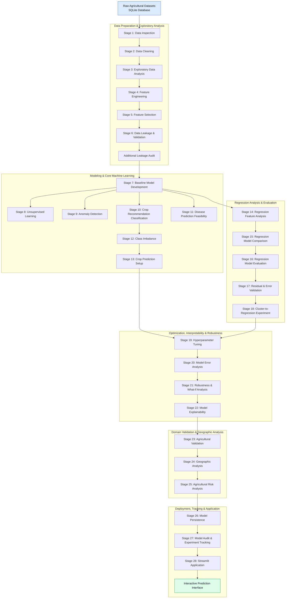

# 🌱 Smart Agriculture Analytics & Machine Learning

*Using data analytics and machine learning to explore crop recommendation, agricultural yield prediction, and agricultural data patterns.*

---

## 📌 Table of Contents

1. [Overview](#overview)
2. [Business Problem](#business-problem)
3. [Project Objectives](#project-objectives)
4. [Datasets](#datasets)
5. [Tools & Technologies](#tools--technologies)
6. [Project Architecture](#project-architecture)
7. [Project Structure](#project-structure)
8. [Data Cleaning & Preparation](#data-cleaning--preparation)
9. [Exploratory Data Analysis](#exploratory-data-analysis)
10. [Feature Engineering](#feature-engineering)
11. [Data Leakage Audit](#data-leakage-audit)
12. [Crop Recommendation](#crop-recommendation)
13. [Agricultural Yield Prediction](#agricultural-yield-prediction)
14. [Unsupervised Learning](#unsupervised-learning)
15. [Anomaly Detection](#anomaly-detection)
16. [Regression Analysis](#regression-analysis)
17. [Optimization & Model Explainability](#optimization--model-explainability)
18. [Agricultural & Geographic Analysis](#agricultural--geographic-analysis)
19. [Streamlit Application](#streamlit-application)
20. [How to Run the Project](#how-to-run-the-project)
21. [Results & Limitations](#results--limitations)
22. [Future Improvements](#future-improvements)
23. [Author](#author)

---

## Overview

Smart Agriculture Analytics & Machine Learning is an end-to-end data analytics and machine learning project focused on exploring agricultural datasets.

The project uses Python for data processing and machine learning, SQLite for local data storage, and Streamlit for an interactive prediction application.

The main components include:

- Crop recommendation using classification algorithms
- Agricultural yield prediction using regression algorithms
- Data cleaning and exploratory data analysis
- Feature engineering and feature selection
- Clustering and anomaly detection
- Model evaluation and comparison
- Model optimization and explainability
- Agricultural and geographic analysis
- Interactive application development

The objective is to investigate how machine learning can be applied to agricultural data while evaluating model performance and documenting its limitations.

---

## Business Problem

Agricultural analysis involves multiple variables, including temperature, rainfall, humidity, soil properties, and nutrient-related measurements.

This project investigates the following problems:

- Predicting crop labels from agricultural input features.
- Exploring whether available features can predict numerical yield values.
- Identifying patterns and relationships in agricultural datasets.
- Comparing different machine learning algorithms.
- Exploring groups of similar agricultural observations.
- Detecting unusual observations.
- Presenting model outputs through an interactive application.

The project is intended for educational and portfolio purposes. Predictions should not be treated as verified agricultural recommendations without independent validation and domain expertise.

---

## Project Objectives

- Clean and prepare agricultural datasets.
- Store and process data using SQLite.
- Perform exploratory data analysis.
- Create derived features from existing variables.
- Perform feature selection.
- Develop classification and regression models.
- Compare multiple machine learning algorithms.
- Explore clustering and anomaly detection.
- Evaluate models using appropriate performance metrics.
- Investigate model errors and robustness.
- Explore model explainability.
- Perform agricultural and geographic analysis.
- Save trained models for reuse.
- Develop a Streamlit application.
- Document model results, limitations, and future improvements.

---

## Datasets

The project uses agricultural datasets stored in a local SQLite database.

### 1. Crop Recommendation Dataset

| Property | Description |
|---|---|
| Records | 2,200 |
| Crop classes | 22 |
| Selected input features | 12 |
| Target variable | `label` |
| Problem type | Multiclass classification |

The selected features include nutrient-related measurements, temperature, humidity, rainfall, and engineered feature combinations.

### 2. Agricultural Yield Dataset

| Property | Training | Testing |
|---|---:|---:|
| Records | 10,000 | 2,000 |
| Selected input features | 10 | 10 |
| Target variable | `yield` | Not available |
| Problem type | Regression | Prediction only |

The training dataset contains the yield target, while the test dataset contains input features without actual yield values.

Therefore, test-set MAE, RMSE, and R² cannot be calculated until the corresponding true yield values become available.

**Database:** SQLite  
**Database file:** `agriculture.db`

The database is stored locally and should only be shared publicly if its data licence and sharing permissions allow it.

---

## Tools & Technologies

### Programming and Data Analysis

- Python
- Pandas
- NumPy
- Jupyter Notebook

### Machine Learning

- Scikit-learn
- Random Forest
- Logistic Regression
- Support Vector Machine
- Decision Tree
- K-Nearest Neighbours
- Gradient Boosting
- XGBoost
- KMeans
- DBSCAN

### Visualisation

- Matplotlib
- Seaborn
- Power BI

### Database

- SQLite
- SQL

### Application and Model Persistence

- Streamlit
- Joblib

### Development and Version Control

- Visual Studio Code
- Git
- GitHub

---

## Project Architecture

The following diagram represents the overall workflow of the Smart Agriculture Analytics project, from raw agricultural datasets to the interactive application.



**Note:** The diagram represents the project's overall workflow and notebook organization. It does not imply that every experiment feeds directly into every subsequent model.

---

## Project Structure

The following is an illustrative project structure. Update the names and folders to match the actual files in the repository.

```text
smart-agriculture-analytics/
│
├── README.md
├── app.py
├── requirements.txt
├── .gitignore
│
├── notebooks/
│   ├── stage1_data_inspection.ipynb
│   ├── stage2_data_cleaning.ipynb
│   ├── stage3_eda.ipynb
│   ├── stage4_feature_engineering.ipynb
│   ├── stage5_feature_selection.ipynb
│   ├── stage6_data_leakage_validation.ipynb
│   ├── leakage_audit.ipynb
│   ├── stage7_baseline_models.ipynb
│   ├── stage8_unsupervised_learning.ipynb
│   ├── stage9_anomaly_detection.ipynb
│   ├── stage10_crop_classification.ipynb
│   ├── stage11_disease_feasibility.ipynb
│   ├── stage12_class_imbalance.ipynb
│   ├── stage13_crop_prediction_setup.ipynb
│   ├── stage14_regression_features.ipynb
│   ├── stage15_regression_comparison.ipynb
│   ├── stage16_regression_evaluation.ipynb
│   ├── stage17_residual_validation.ipynb
│   ├── stage18_cluster_regression.ipynb
│   ├── stage19_hyperparameter_tuning.ipynb
│   ├── stage20_model_error_analysis.ipynb
│   ├── stage21_robustness_analysis.ipynb
│   ├── stage22_model_explainability.ipynb
│   ├── stage23_agricultural_validation.ipynb
│   ├── stage24_geographic_analysis.ipynb
│   ├── stage25_agricultural_risk_analysis.ipynb
│   ├── stage26_model_persistence.ipynb
│   ├── stage27_model_audit.ipynb
│   └── stage28_streamlit_application.ipynb
│
├── stage26_models/
│   ├── crop_classifier.joblib
│   └── yield_predictor.joblib
│
├── stage8_outputs/
│
├── reports/
│
└── powerbi/
    └── dashboard_files.pbix
```

Only retain entries that actually exist in the project. The SQLite database may remain local if it should not be published.

---

## Data Cleaning & Preparation

The data preparation workflow includes:

- Inspecting table schemas and data types.
- Checking missing values and duplicate records.
- Preparing cleaned datasets.
- Creating engineered features.
- Preparing selected feature tables.
- Separating target variables from input features.
- Preparing data for model training and evaluation.

The project uses SQLite to store the datasets and their processed versions.

---

## Exploratory Data Analysis

Exploratory Data Analysis (EDA) helps understand the structure and characteristics of the agricultural datasets.

Areas of analysis include:

- Distribution of numerical features.
- Relationships between environmental variables.
- Nutrient-related features.
- Crop-label distribution.
- Missing values and duplicate records.
- Relationships between input features and targets.

Any conclusions about agricultural patterns should be based on the actual dataset and verified analysis outputs.

---

## Feature Engineering

Feature engineering creates additional variables from existing data.

### Crop Recommendation Features

Selected crop features include:

- `P_K_Ratio`
- `NPK_Total`
- `Temperature_Rainfall`
- `N_K_Ratio`
- `Humidity_Rainfall`
- `Temperature_Humidity`

### Agricultural Yield Features

Selected yield features include:

- `NDVI_Temperature`
- `OrganicMatter_Sand`
- `Temperature_Rainfall`
- `NDVI_Rainfall`
- `Humidity_Rainfall`
- `Temperature_Humidity`

Additional selected features include existing soil and environmental measurements.

Feature selection and target-informed preprocessing should be performed inside the training folds when evaluating models to avoid data leakage.

---

## Data Leakage Audit

Data leakage occurs when information from testing data influences model training, preprocessing, feature selection, or model selection.

The project includes a separate leakage-audit workflow to investigate potential leakage risks.

### Areas Checked

- Missing values and duplicate records.
- Train-test splitting.
- Identical feature rows across training and testing sets.
- Preprocessing using pipelines.
- Imputation and scaling within cross-validation.
- Model comparison using training cross-validation.
- Separate holdout evaluation.
- Comparison against a baseline model.

### Leakage Prevention

The modelling workflow uses Scikit-learn pipelines to ensure that preprocessing operations such as imputation and scaling are fitted on training data within each cross-validation fold.

**Important limitation:** The original feature-selection process requires separate verification. If feature selection was performed using the complete dataset before splitting, the reported model scores may be optimistic. The existing selected-feature tables alone cannot establish that the original feature-selection process was leakage-free.

---

## Crop Recommendation

The crop recommendation task predicts the `label` column using 12 selected input features.

### Models Explored

- Logistic Regression
- Support Vector Machine
- Decision Tree
- Random Forest
- K-Nearest Neighbours
- XGBoost

### Preliminary Cross-Validation Results

| Model | Mean CV Accuracy |
|---|---:|
| Random Forest | 98.92% |
| XGBoost | 98.01% |
| Decision Tree | 97.90% |
| SVM | 97.61% |
| Logistic Regression | 97.05% |

Random Forest achieved the highest reported initial mean cross-validation accuracy.

However, these results are preliminary because the original feature-selection process still requires verification for potential data leakage.

A separate exploratory holdout experiment reported 99.55% accuracy for XGBoost. Since the model was selected using the same holdout results, that score should not be presented as an independent final performance estimate.

---

## Agricultural Yield Prediction

The regression task estimates a numerical yield value from 10 selected input features.

### Models Explored

- Dummy Regressor
- Linear Regression
- Random Forest Regressor
- Gradient Boosting Regressor
- Decision Tree Regressor
- XGBoost Regressor

### Preliminary Cross-Validation Results

| Model | MAE | RMSE | R² |
|---|---:|---:|---:|
| Dummy Regressor | 378.89 | 436.52 | -0.0004 |
| Linear Regression | 378.75 | 436.66 | -0.0011 |
| Gradient Boosting | 380.06 | 438.65 | -0.0102 |
| Random Forest | 384.73 | 446.23 | -0.0455 |
| XGBoost | 384.84 | 446.86 | -0.0485 |
| Decision Tree | 512.36 | 626.89 | -1.0635 |

### Interpretation

- MAE measures the average absolute prediction error.
- RMSE penalises larger prediction errors more heavily.
- R² compares the model against a mean-based reference.

The tested models did not meaningfully outperform the Dummy Regressor baseline.

Consequently, the yield predictor remains an experimental component rather than a reliable forecasting model.

The yield target's real-world unit has not yet been confirmed. The test dataset also has no actual yield values, preventing independent test-set evaluation.

---

## Unsupervised Learning

The project explores unsupervised learning to investigate structure in the crop recommendation dataset.

### Analysis Performed

- Standardisation of numerical features.
- KMeans clustering with different values of K.
- Inertia and silhouette-score analysis.
- Elbow-method analysis.
- PCA-based visualisation.
- DBSCAN clustering and noise detection.
- Cluster profiling.
- Comparison of cluster assignments with existing crop labels.

The existing `label` target is excluded from clustering inputs and retained only for post-clustering comparison.

Cluster counts, silhouette scores, and interpretations should be taken from the executed notebook outputs rather than assumed from the algorithm settings.

---

## Anomaly Detection

The project includes an anomaly-detection stage to investigate unusual observations in the agricultural data.

The purpose is to explore observations that differ from the general data patterns.

Anomaly detection results should be interpreted carefully because an unusual measurement is not necessarily an incorrect agricultural observation.

---

## Regression Analysis

The regression workflow investigates the relationship between selected agricultural features and numerical yield values.

It includes:

- Regression feature analysis.
- Comparison of regression algorithms.
- Model evaluation using MAE, RMSE, and R².
- Residual analysis.
- Error distribution checks.
- Cluster-based regression experiments.

The regression results indicate that further investigation of the available features and target variable is necessary.

---

## Optimization & Model Explainability

The project includes experiments and analysis related to:

- Hyperparameter tuning.
- Model error analysis.
- Robustness and what-if analysis.
- Model explainability.
- Feature importance and interpretation.

These techniques help investigate model behaviour, identify weaknesses, and understand how input variables influence predictions.

Any specific SHAP, LIME, or tuning results should be reported only where supported by executed notebook outputs.

---

## Agricultural & Geographic Analysis

The project also includes domain-oriented analysis.

### Agricultural Validation

Investigates whether model outputs and data patterns are consistent with available agricultural knowledge.

### Geographic Analysis

Explores geographic distributions and spatial patterns where geographic data is available.

### Agricultural Risk Analysis

Investigates agricultural risks and vulnerabilities using the available dataset information.

These analyses are exploratory and should not be interpreted as independently validated agricultural advice.

---

## Streamlit Application

The project includes a Streamlit application prototype that provides an interactive interface for the machine learning workflows.

### Crop Recommendation

Accepts agricultural input features and returns a predicted crop label.

### Yield Prediction

Produces an experimental numerical yield estimate using the saved regression pipeline.

### Model Insights

Presents model comparisons and evaluation information.

### Run the Application

```bash
python -m streamlit run app.py
```

This command assumes that `app.py` exists in the project root. The application, model paths, dependencies, and database connections must match the actual repository configuration.

---

## How to Run the Project

### 1. Clone the Repository

Replace the repository URL with the actual public GitHub repository URL.

```bash
git clone YOUR_REPOSITORY_URL
cd smart-agriculture-analytics
```

### 2. Create a Virtual Environment

```bash
python -m venv .venv
```

On Windows:

```bash
.venv\Scripts\activate
```

### 3. Install Dependencies

```bash
pip install -r requirements.txt
```

The `requirements.txt` file should list the packages actually required by the notebooks and application.

### 4. Configure the Database

Ensure that `agriculture.db` exists at the location expected by the project code.

Update the database path if necessary.

Do not assume that the database is included in the cloned repository.

### 5. Run the Notebooks

```bash
jupyter notebook
```

Open the relevant notebook and run its cells in order.

### 6. Run the Streamlit Application

```bash
python -m streamlit run app.py
```

Follow the local URL displayed in the terminal.

---

## Results & Limitations

### Key Findings

- Initial crop classification experiments reported high cross-validation accuracy.
- The original crop feature-selection process requires leakage verification.
- The exploratory XGBoost holdout result is not an independent final estimate.
- Yield regression did not meaningfully outperform the Dummy Regressor baseline.
- The yield test dataset does not contain actual target values.
- Clustering provides an exploratory view of the structure in the crop dataset.
- Agricultural interpretations require independent domain validation.

### Limitations

- Preliminary crop scores may be optimistic if feature selection used the full dataset.
- Yield prediction performance remains weak in the reported experiments.
- The unit and exact meaning of the yield target are unconfirmed.
- Real-world agricultural use requires independent validation and domain expertise.
- Geographic and agricultural conclusions depend on the availability and quality of the underlying data.
- The application should not be treated as a verified agricultural decision-support system.

---

## Future Improvements

- Complete the original feature-selection leakage verification.
- Perform a final leakage-safe crop classification evaluation.
- Investigate yield target meaning and feature quality.
- Improve yield prediction using more relevant data.
- Test prediction workflows using actual dataset-derived inputs.
- Add input validation and robust error handling.
- Verify Power BI dashboard calculations against the source data.
- Improve reproducibility with documented dependencies and paths.
- Explore additional model explainability techniques.
- Strengthen agricultural domain validation.
- Deploy the application after successful final verification.

---

## Conclusion

Smart Agriculture Analytics & Machine Learning combines data analytics, feature engineering, supervised learning, unsupervised learning, regression analysis, and application development in an agricultural context.

The initial crop classification results are promising but require further leakage verification. Yield regression highlights the importance of baseline comparisons and appropriate model evaluation.

The project demonstrates an end-to-end machine learning workflow while documenting the limitations of the available data and models.

---

## Author

**Girish Dodeja**

AI & ML Student | Aspiring Data Analyst | Machine Learning Enthusiast

- **GitHub:** [girishchs2006-rgb](https://github.com/girishchs2006-rgb)
- **LinkedIn:** [Girish Dodeja](https://www.linkedin.com/in/girish-dodeja-6637b8254)
- **Email:** girishchs2006@gmail.com

---

⭐ If you find this project useful, consider giving the repository a star on GitHub.